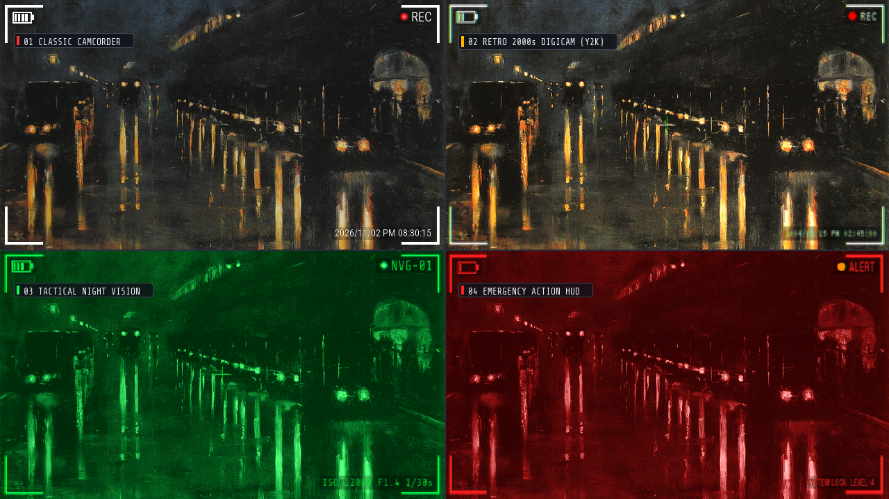
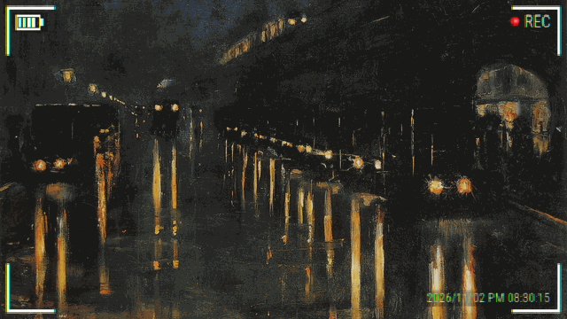
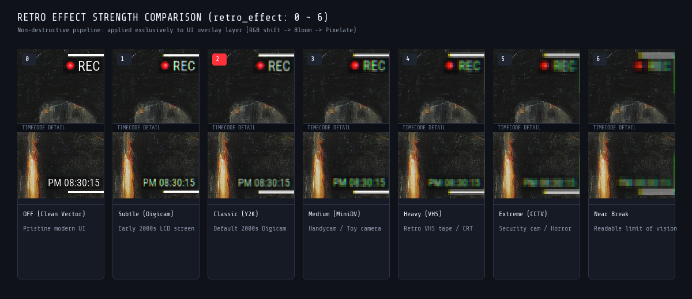
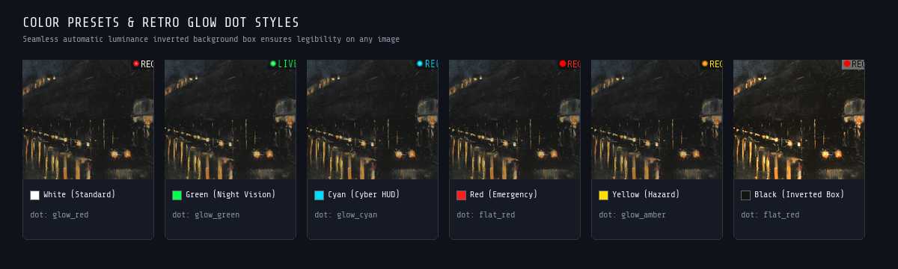

# rec-frame-ComfyUI

**English** | [🇯🇵 日本語ドキュメント (README_JA.md)](./README_JA.md)

[](./LICENSE)
[](https://github.com/comfyanonymous/ComfyUI)
[](https://www.python.org/downloads/)

A powerful, pixel-perfect camera viewfinder overlay custom node for ComfyUI.  
Effortlessly composite realistic camcorder and digital camera HUDs—including **corner L-frames, battery indicators, blinking red REC dots, center focus crosses, date/timecodes, semi-transparent background boxes, and retro UI degradation effects (chromatic aberration, CRT bloom, downsampling)**—directly onto your image and video generation pipelines.

Ported and optimized from [treeturtlefall-arch/rec-frame-app](https://github.com/treeturtlefall-arch/rec-frame-app) with full video batch support (AnimateDiff, Wan, MiniMax, CogVideoX, etc.).

---

## Visual Showcase

### 4 Representative Viewfinder Styles


### Video Pipeline Demo (Blinking Red Dot & Real-time Timecode Advance)


---

## Key Features

1. **Short-Edge Relative Vector Scaling (`s = min(w, h)`)**
   - All HUD dimensions scale smoothly relative to the shorter dimension. No stretched PNG assets—crisp, perfectly balanced geometry across widescreen 16:9, square 1:1, or vertical 9:16 aspect ratios.
2. **Pixel-Perfect Equal-Length Corner L-Frames**
   - Corrected for PIL's inclusive coordinate bounds with exact `-1` offsets. All four corner brackets have identical horizontal and vertical pixel lengths and equal outer margins.
3. **Specialized Image & Video Separation**
   - `RecFrameImageOverlay` for ultra-fast, zero-overhead single-pass image compositing.
   - `RecFrameVideoOverlay` with intelligent LRU caching for video batches, advancing timecodes and blinking red dots with minimal frame redrawing overhead.
4. **No-Queue Dynamic Live Preview (`RecFramePreview`)**
   - Connect the `overlay_rgba` output to `RecFramePreview` to see slider adjustments (thickness, fonts, colors, toggles) update instantly inside ComfyUI **without pressing Queue Prompt**.
5. **Unified Non-Destructive Retro Degradation (`retro_effect: 0 to 6`)**
   - Seamlessly simulates authentic retro optical and digital display artifacts (RGB chromatic aberration → CRT bloom glow → pixel downsampling). Applied exclusively to the UI overlay layer, keeping your underlying image/video pristine.
6. **Self-Contained Fonts (No OS System Folder Access)**
   - Includes 6 open-source fonts (SIL OFL) in `fonts/`. Never queries Windows/Linux/macOS system fonts for privacy and cross-platform determinism. Supports drop-in custom `.ttf`/`.otf`/`.ttc` fonts.

---

## Included Nodes (Category: `image/overlay`)

| Node Display Name | Class Name | Purpose |
|---|---|---|
| **`REC Frame (Image) [画像用]`** | `RecFrameImageOverlay` | Dedicated still image node. Streamlined UI without video-specific timing parameters. Generates standalone transparent overlays if no image is connected. |
| **`REC Frame (Video) [動画用]`** | `RecFrameVideoOverlay` | Dedicated video/batch node with frame-accurate red dot blinking (`blink_red_dot_interval`) and timecode auto-advance (`advance_timecode_fps`). |
| **`Preview REC Overlay (枠プレビュー)`** | `RecFramePreview` | Live interactive preview node for immediate visual inspection without queuing prompts. Includes 4 background options (Black, White, Gray, Checkerboard). |
| **`REC Frame Overlay (All-in-One / Legacy)`** | `RecFrameOverlay` | Backward-compatible consolidated node for existing workflows. |

---

## Parameter Reference

### Required Settings
| Parameter | Type / Options | Default | Description |
|---|---|---|---|
| `color` | `white`, `black`, `green`, `cyan`, `red`, `yellow` | `white` | Viewfinder theme color preset (affects frames, battery, text, center cross). |
| `font_key` | Dropdown (6 bundled + custom) | `Roboto Condensed Bold(細長)` | Bundled open-source typography or user fonts in `fonts/`. |
| `retro_effect` | `INT` (Slider 0 to 6) | `0` | UI degradation intensity (0: Clean vector, 2: Classic 2000s, 6: Near Break). |
| `show_frame` | `BOOLEAN` | `True` | Toggle corner L-shaped viewfinder brackets. |
| `thickness` | `INT` (Slider 0 to 100) | `50` | Bracket stroke thickness (0: hairline ~1px, 50: standard, 100: bold impact). |
| `show_rec` | `BOOLEAN` | `True` | Toggle recording indicator block (dot + text). |
| `dot_style` | Dropdown (Assets list) | `flat_red` | Dot asset style (`flat_*` solid circle, `glow_*` anime aura, `classic` geometric circle). |
| `rec_label` | `STRING` | `"REC"` | Text string next to dot (e.g. `"LIVE"`, `"PLAY"`, `"STBY"`, `"ALERT"`). |
| `show_battery` | `BOOLEAN` | `True` | Toggle battery gauge. |
| `battery_bars` | `INT` (0 to 4) | `4` | Number of battery level bars (0 expresses depleted/blinking battery). |
| `show_cross` | `BOOLEAN` | `False` | Toggle center crosshairs focus mark. |
| `show_timecode` | `BOOLEAN` | `False` | Toggle timestamp/timecode display. |
| `timecode_mode` | `manual`, `now` | `manual` | Manual custom text vs. current local time auto-fill. |
| `timecode_text` | `STRING` | `""` | Timestamp text (`YYYY/MM/DD AM/PM HH:MM` or any custom string). |

### Optional & Advanced Video Settings
| Parameter | Type | Default | Description |
|---|---|---|---|
| `images` / `image` | `IMAGE` | Optional | Input image or video batch `[B, H, W, C]`. Generates standalone overlay if unconnected. |
| `custom_color` | `STRING` | `""` | Direct HEX color override (e.g. `#00FF50`). Highest priority over `color`. |
| `custom_font_path` | `STRING` | `""` | Direct path to external `.ttf`/`.otf`/`.ttc` font file (works immediately without restart). |
| `custom_dot_path` | `STRING` | `""` | Direct path to custom dot/logo `.png`/`.webp` image (works immediately without restart). |
| `bg_box_opacity` | `FLOAT` (0.0 to 1.0) | `0.10` | Opacity of semi-transparent backdrop boxes (auto-inverts white/black based on luminance). |
| `margin_ratio` | `FLOAT` (0.0 to 0.2) | `0.020` | Outer margin ratio of corner brackets relative to short edge. |
| `arm_len_ratio` | `FLOAT` (0.01 to 0.5) | `0.15` | Bracket arm length ratio (increase to `0.18`-`0.20` for wider, cinematic brackets). |
| `blink_red_dot_interval` | `INT` (Video) | `0` | Blinking frame interval (0: always on; e.g. `12` blinks every 0.5s at 24fps). |
| `advance_timecode_fps` | `FLOAT` (Video) | `0.0` | Frame rate for auto-advancing timecode seconds (0.0: static). |
| `empty_width` / `empty_height` | `INT` | 1280x720 | Canvas resolution when generating standalone transparent overlays. |
| `empty_frames` | `INT` (Video) | `24` | Number of frames to generate when running standalone video node. |

---

## Visual Comparison

### Retro UI Degradation Levels (`retro_effect: 0 to 6`)


* **`0: OFF (Clean Vector)`**: Modern, high-resolution vector HUD. Razor-sharp edges with zero degradation.
* **`1: Subtle (Digicam)`**: Gentle optical blur mimicking early 2000s LCD viewfinders. Blends naturally with modern AI images.
* **`2: Classic (Y2K)`**: Standard 2000s consumer digicam aesthetic with balanced chromatic aberration and CRT bloom.
* **`3: Medium (MiniDV)`**: Moderate analog tape and handycam screen softening.
* **`4: Heavy (VHS)`**: Heavy phosphor bloom and CRT monitor scan degradation.
* **`5: Extreme (CCTV)`**: Gritty surveillance camera, security footage, or horror found-footage feel.
* **`6: Near Break`**: Extreme glitch limit—degraded to the absolute edge of human perceptual decipherability.

### Color Presets & Retro Glow Dots


Includes 6 built-in presets (`white`, `green`, `cyan`, `red`, `yellow`, `black`) and arbitrary HEX code support.  
The dynamic background box (`bg_box_opacity`) automatically computes perceived luminance: dark themes get a soft white backdrop, while light/neon themes get a soft black backdrop, ensuring readability over any footage.

---

## Bundled Open-Source Typography

All fonts are self-contained in `fonts/` (SIL Open Font License 1.1):

1. **`Roboto Condensed Bold(細長)`** — Standard modern camera viewfinder.
2. **`Bebas Neue(縦長大文字)`** — Cinematic, bold all-caps title typography.
3. **`DSEG7 Classic(7セグLED)`** — Digital 7-segment LCD counter & clock display.
4. **`Share Tech Mono(等幅)`** — Night vision goggles, telemetry, and cyber HUD.
5. **`VT323(レトロドット)`** — Authentic 90s/2000s Y2K pixel dot-matrix typography.
6. **`Zen Kaku Gothic(日本語)`** — High-legibility Japanese Gothic typography.

---

## Official Workflows (ComfyUI Desktop Ready)

Ready-to-use workflows are included in [`workflows/`](./workflows/) and automatically synced to ComfyUI Desktop's workflow browser under `rec-frame/`:

1. **Basic Still Image Workflow ([`rec_frame_basic_workflow.json`](./workflows/rec_frame_basic_workflow.json))**
   - `Load Image` → `RecFrameImageOverlay` & `RecFramePreview` → `Save Image`.
2. **2000s Digicam Preset Workflow ([`rec_frame_2000s_digicam_workflow.json`](./workflows/rec_frame_2000s_digicam_workflow.json))**
   - Features `VT323` dot font, `retro_effect: 2`, center crosshair, 2-bar battery, and backdrop boxes.
3. **Video Animation Batch Workflow ([`rec_frame_video_batch_workflow.json`](./workflows/rec_frame_video_batch_workflow.json))**
   - Complete video pipeline with `RecFrameVideoOverlay` (`blink_red_dot_interval: 24`, `advance_timecode_fps: 24.0`).

---

## Installation

### Method 1: ComfyUI-Manager (Recommended)
1. Open the **Manager** menu inside ComfyUI.
2. Click **Custom Nodes Manager**.
3. Search for `rec-frame` or `REC Frame`.
4. Click **Install** and restart ComfyUI.

### Method 2: Manual Git Clone
Run the following in your terminal:

```bash
cd ComfyUI/custom_nodes
git clone https://github.com/treeturtlefall-arch/rec-frame-ComfyUI.git
```

Dependencies (Pillow, PyTorch, torchvision) are standard ComfyUI requirements—no additional `pip install` needed!

---

## Frequently Asked Questions (FAQ)

### Q. Do the top corner L-frames look shorter than the bottom ones? Is this a bug?
**A. All four corner brackets are mathematically identical in length down to the exact pixel.**  
Because horizontal UI elements (battery indicator on top-left, REC indicator on top-right) sit directly beside the upper brackets, the brain experiences an optical contrast illusion and the vertical-horizontal illusion (perceiving vertical lines as 10-20% longer than horizontal lines).  
If you prefer wider, more expansive top brackets, simply set **`arm_len_ratio` to `0.18` ~ `0.20`** (default is 0.15).

### Q. How can I use my own custom fonts or dot images/logos?
**A. You can use either of the following two methods:**
* **Method A: Direct Path Input (Instant test, no ComfyUI restart needed)**
  * Paste your local file path directly into `custom_font_path` (for `.ttf`/`.otf`/`.ttc`) or `custom_dot_path` (for `.png`/`.webp`). Updates immediately!
* **Method B: Folder Placement (Permanent dropdown registration)**
  * Put font files into `fonts/` and custom dot images into `assets/dots/`. Restart ComfyUI to have them automatically populate in the node dropdown menus.

---

## License & Credits

- **rec-frame-ComfyUI**: [MIT License](./LICENSE)
- Upstream project: [treeturtlefall-arch/rec-frame-app](https://github.com/treeturtlefall-arch/rec-frame-app)
- **Bundled Fonts**:
  - Roboto Condensed, Bebas Neue, DSEG7 Classic, Share Tech Mono, VT323, Zen Kaku Gothic: [SIL Open Font License 1.1](./fonts/OFL.txt)
