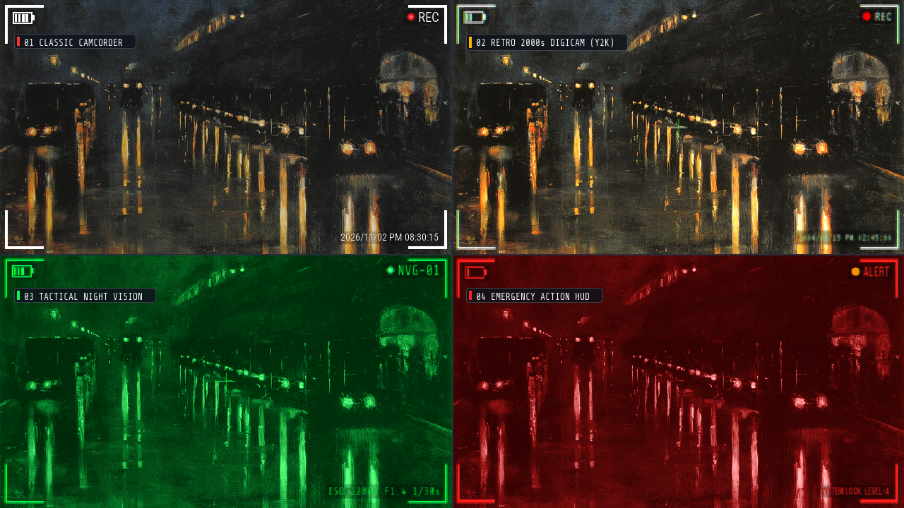
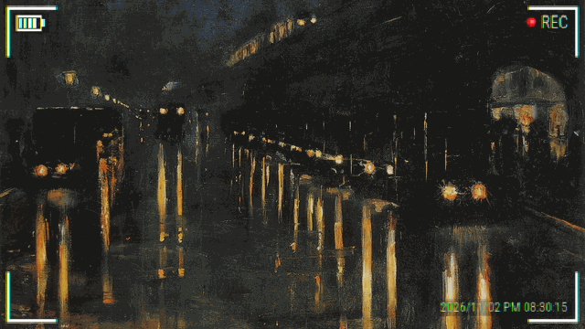
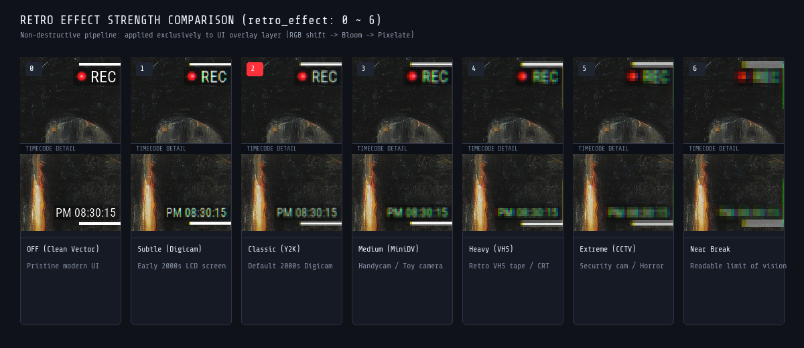
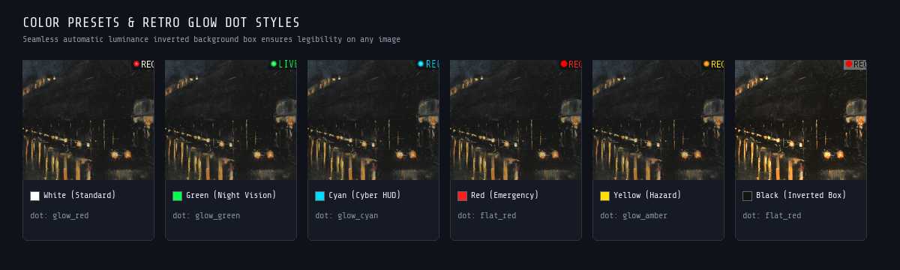

<div align="center">

# 🔴 rec-frame-ComfyUI

### プロ仕様の幾何学ベクター・錯視補正・非破壊レトロ劣化を備えた カメラファインダーHUD合成ノード

[](https://github.com/treeturtlefall-arch/rec-frame-ComfyUI/releases)
[](https://github.com/comfyanonymous/ComfyUI)
[](https://www.python.org/)
[](#-3段階の非破壊レトロui劣化パイプライン-retro_effect-06)
[](LICENSE)
[](fonts/LICENSE-OFL.txt)

**[🇺🇸 English](README.md)** | **[🇯🇵 日本語 (Japanese)](README_JA.md)**

[なぜ幾何学ベクターなのか？](#-なぜ幾何学ベクター--錯視補正なのか) •
[静止画・動画の役割分離](#-静止画動画の役割分離アーキテクチャ) •
[リアルタイムプレビュー](#-queue不要のリアルタイムプレビュー-recframepreview) •
[レトロUI劣化](#-3段階の非破壊レトロui劣化パイプライン-retro_effect-06) •
[厳選6フォント](#-同梱6フォント--マーク素材完全自己完結) •
[公式ワークフロー](#-公式ワークフローcomfyui-desktop-対応) •
[パラメータ仕様](#%EF%B8%8F-設定パラメータ仕様)

<br>



*固定PNG素材の引き伸ばし歪みからの完全脱却。短辺基準の数学的ベクター計算と厳密インクセンタリングが実現する、ピクセルパーフェクトなカメラファインダーHUD。*

</div>

---

## 🔬 なぜ「幾何学ベクター ＆ 錯視補正」なのか？

カメラのビューファインダーやシネマHUDオーバーレイは、 **「固定解像度のPNG枠を画像の上に引き伸ばして貼るだけ」では美しく成立しません** 。縦長ショート動画（9:16）や正方形（1:1）でアスペクト比が変わると線の太さが歪み、フォントのアセンダ・ディセンダ差によって文字が上下に浮き、対比錯視によって上部のL字枠が詰まって見えるという問題が発生します。

元リポジトリ [treeturtlefall-arch/rec-frame-app](https://github.com/treeturtlefall-arch/rec-frame-app) から継承・進化した **rec-frame-ComfyUI** は、短辺基準の純粋幾何学ベクター計算と錯視工学により、あらゆる解像度・アスペクト比で完璧なHUDを描画します：

| 項目・設計思想 | 従来の固定PNG枠貼り付け | 一般的なHUD・文字ノード | **rec-frame-ComfyUI** |
| :--- | :---: | :---: | :---: |
| **可変アスペクト比対応** | ❌ 縦型(9:16)や正方形で枠やマークが歪む | ⚠️ 座標の手動再計算が必要 | ✅ **短辺基準ベクター計算 (`s = min(w, h)`)** （全比率で完全無歪み） |
| **四隅の描画精度** | ❌ 引き伸ばしで線がぼやける | ⚠️ PILの仕様で右下・左上の長さが1pxズレる | ✅ **`-1` 境界補正によるピクセルパーフェクト等長描画** |
| **文字・マークの配置** | ❌ アセンダ/ディセンダで文字が上下に浮く | ⚠️ 目測による大まかな配置 | ✅ **実インク計測による幾何中心一致 ＆ 錯視クリアランス** |
| **動画・フレーム同期** | ❌ 点滅で文字位置がガタつく | ⚠️ フレームレートと点滅周期の不一致 | ✅ **外部FPS自動同期 ＋ 骨格維持点滅 ＋ SMPTEタイムコード** |
| **プレビュー体験** | ❌ 毎回キュー実行が必要（時間消費） | ❌ 毎回キュー実行が必要 | ✅ **フロントエンド拡張によるキュー不要の即時ダイナミックプレビュー** |
| **質感・劣化エフェクト** | ❌ 背景画像ごと劣化してしまう | ❌ 単純な全体ブラーのみ | ✅ **UI層のみに非破壊でかかる3段階レトロパイプライン（0〜6）** |
| **可読性保証** | ❌ 背景が同色だと溶けて見失う | ⚠️ 固定色の枠・縁取りのみ | ✅ **知覚輝度連動の白/黒自動反転半透明座布団** |

---

### 📐 妥協なきピクセル精度と錯視工学の3原則

1. **短辺基準の相対ベクター計算 (`s = min(w, h)`)**:
   - すべての寸法（マージン、線幅、文字サイズ、マーク半径）は短辺 $s$ を基準とした比率で動的に算出。16:9シネマスコープ、4:3、1:1スクエア、9:16縦型リールなど、どんな解像度でも線の太さやプロポーションが狂いません。
2. **四隅の端距離ピクセル一致（PIL `-1` inclusive 補正）**:
   - PIL の `ImageDraw.rectangle` は終端座標を含む inclusive 描画仕様のため、愚直に計算すると右隅・下隅の長さが 1px 狂います。本ノードは座標起点に厳密な `-1` 補正を施し、四隅すべてが **1ピクセルの狂いもなく完全に同一の長さ・均等マージン** で描画されます。
3. **実インク幾何中心センタリング（`_tight_ink_metrics`）**:
   - 単純な `anchor="lm"` 指定では、フォント固有のアセンダ/ディセンダや余白により文字が上下に浮いてしまいます。本ノードは `font.getmask2(..., anchor="lt")` を使って **「実際に描画されるインクの外接矩形」** を直接計測。赤丸マークとREC文字の幾何中心線をピクセル単位で一致させます。

---

## 🎬 静止画・動画の役割分離アーキテクチャ

静止画生成と動画生成（AnimateDiff, Wan, MiniMax, CogVideoX 等）では求められるパフォーマンス要件が根本から異なります。rec-frame-ComfyUI は用途に合わせてノードを完全分離し、最高の操作性と実行速度を提供します。



### 1. `RecFrameImageOverlay`（静止画パイプライン特化）
動画専用のパラメータ（点滅間隔やFPS）を削ぎ落とした洗練されたUI。
- バッチ処理時でもオーバーレイ（RGBA）を最初の1回のみ生成し、全フレームに対して `torch.lerp` で一括高速合成（余計なキャッシュ検索やフレーム毎の再描画をゼロ化）。
- 入力画像が未接続の場合は、`empty_width` / `empty_height`（既定 1280x720）により **単体オーバーレイPNGジェネレーター** として透過HUDを出力。

### 2. `RecFrameVideoOverlay`（動画・連続フレーム特化）
生成モデル固有のフレームレートに完全追従する本格動画ノード。
- **外部FPS自動同期 (`fps` 入力ピン)**: `GetVideoComponents` などの FPS 出力を接続すると、内部のタイムコード進行と赤丸点滅周期が動画の本来の再生速度に完全同期。
- **骨格維持点滅 (`red_dot_visible`)**: 点滅で赤丸が消灯するフレームでも、レイアウト構造を一切崩さずREC文字や座布団の位置をピタリと固定。
- **SMPTE規格フレームタイムコード (`smpte`)**: 放送規格の `HH:MM:SS:FF` 形式でフレーム単位の進行を正確にカウントアップ。
- **LRU/FIFOキャッシュ最適化 (`MAX_CACHE_SIZE = 32`)**: 長尺動画でもメモリを圧迫せず、最小限の描画コストで超高速処理を実現。

> [!IMPORTANT]
> **動画パイプラインの鉄則: 「オーバーレイは一番最後に配置する（Overlay Belongs Last）」**  
> ワークフローに **フレーム補間（RIFE, FILM 等）** や **AIアップスケール（RealESRGAN, NNLatentUpscale 等）** を組み込む場合は、必ずそれらの **後** （動画保存ノードの直前）に `RecFrameVideoOverlay` を配置してください。  
> * **理由**: オーバーレイの後に補間を挟むと、前後のフレームから文字や枠がモーフィング処理されて滲み（smear）、フレーム数倍増でタイムコード速度がズレてしまいます。HUDは常に最終合成ステップとするのが基本です。

---

## ⚡ Queue不要のリアルタイムプレビュー (`RecFramePreview`)

ComfyUI でHUDを調整する際、 **「スライダーを動かすたびに Queue Prompt を押して待つ」というストレスを完全に排除** しました。

フロントエンド拡張スクリプト（`web/js/rec_frame_preview.js`）がオーバーレイノードと `RecFramePreview` 間の接続をリアルタイムに検知。枠の太さ（`thickness`）、フォント、カラー、表示トグル、座布団の不透明度などを動かした瞬間、専用APIエンドポイント経由で **ノード内のプレビュー画面が即座にダイナミック更新** されます。

- **背景色切り替え**: 黒、白、グレー、透過市松模様（Checkerboard）の4種類から選択可能。
- **解像度スケーリング**: Full, 1/2, 1/4 から切り替え可能。
- **パイプライン接続**: プレビュー専用としてだけでなく、後続の画像保存ノードへ `IMAGE` 出力も可能です。

---

## 📺 3段階の非破壊レトロUI劣化パイプライン (`retro_effect: 0〜6`)

直感的なスライダー **`retro_effect`（0〜6）** 1本で、現代の高精細ベクターから懐かしい2000年代デジカメ、荒廃した監視カメラの質感までを無段階に表現できます。



> [!NOTE]
> **原本画像を傷つけない「UI層限定適用」**:  
> エフェクトはベースとなる写真や動画フレームには一切適用されず、 **描画済みの UI オーバーレイ層（RGBA）に対してのみ非破壊で適用** されます。大切な生成画像の解像度やディテールを落とすことなく、画面上のHUDだけを自然に劣化させます。

### レトロ劣化強度一覧

| レベル | スタイル名 | 視覚効果と質感 | 主な用途・世界観 |
| :---: | :--- | :--- | :--- |
| **`0`** | **OFF (Clean Vector)** | 現代的な高精細ベクター描画。ノイズや滲みのないクリーンな仕上がり | 最新ミラーレスカメラ、ドローン空撮HUD、SFサイバーインターフェース |
| **`1`** | **Subtle (Digicam)** | 2000年代初期液晶ディスプレイの微かなにじみ | 現代のAI生成画像に違和感なく馴染む自然なファインダー表現 |
| **`2`** | **Classic (Y2K)** | **標準プリセット**。適度なRGBシフトとCRTブルームによる2000sデジカメ質感 | 平成レトロ、オールドコンデジスナップ、日常Vlog風演出 |
| **`3`** | **Medium (MiniDV)** | ハンディカムやトイカメラ風のやや強めな光学・液晶劣化 | 90年代末〜2000年代初頭の家庭用ビデオカメラ、自主映画風 |
| **`4`** | **Heavy (VHS)** | ブラウン管モニターやレトロVHSテープの強い走査線・光のにじみ | レトロホラー、VHSファウンドフッテージ、アナログテレビ中継 |
| **`5`** | **Extreme (CCTV)** | 荒廃した監視カメラ・低解像度セキュリティ映像の質感 | ガレージ監視カメラ、バックルーム（Backrooms）、SFポストアポカリプス |
| **`6`** | **Near Break** | 人間の知覚から見て文字やマークを推測・判読できる極限境界 | 破損フッテージ、SCP極秘記録、宇宙船遭難記録HUD |

<details>
<summary><b>🧬 クリックして3段階非破壊パイプラインの内部構造を表示</b></summary>

<br>

```text
       [ 純粋ベクターUI描画層 (RGBA) ]
                      │
                      ▼
 ┌─────────────────────────────────────────┐
 │ Stage 1 — 色収差 (RGBシフト)            │  赤・青チャンネルをピクセルオフセットし
 │          Chromatic Aberration           │  安価な光学レンズの色にじみを再現
 └────────────────────┬────────────────────┘
                      │
                      ▼
 ┌─────────────────────────────────────────┐
 │ Stage 2 — CRT蛍光ブルーム (Bloom Glow) │  UIの描画輝度に応じた光の拡散
 │          Optical Surface Blur           │  (白枠と黒枠で半径・アルファを独立最適化)
 └────────────────────┬────────────────────┘
                      │
                      ▼
 ┌─────────────────────────────────────────┐
 │ Stage 3 — 液晶低解像度化 (Downsampling) │  短辺比率に応じた最近傍リサンプリング
 │          Pixel Grid Decimation          │  CRTや初期液晶のドット格子感を付与
 └────────────────────┬────────────────────┘
                      │
                      ▼
    [ 完成したUI劣化オーバーレイ層 (RGBA) ]
                      │
                      ▼  (torch.lerp / alpha_composite)
    [ 未加工の美麗なベース画像 / 動画フレーム ]
```

エフェクト適用順序は **「RGBシフト → ブルーム → 低解像度化」** で厳密に固定されています。ブルームの後に解像度を下げることで、初期デジカメの低解像度CCDや液晶ディスプレイ特有の「格子状に滲むアーティファクト」を数学的に再現しています。

</details>

---

## 🎨 視認性を極めるカラープリセット ＆ 知覚輝度反転座布団

どんな背景画像の上に乗せても文字や枠を見失わないよう、インテリジェントな視認性保護機構を備えています。



### 1. 6色のテーマカラー ＋ 任意HEXコード指定
- プリセットカラー: `white`（白）、`green`（暗視グリーン）、`cyan`（サイバーシアン）、`red`（警告レッド）、`yellow`（注意イエロー）、`black`（モノトーンブラック）。
- `custom_color` に `#00FF88` 等の HEX コードを入力すると、カラープリセットを上書きして任意の色を適用できます。

### 2. 知覚輝度連動の自動反転座布団 (`bg_box_opacity`)
電池マーク、REC文字、日時タイムコードの背後に配置される半透明シャープボックス（座布団）は、文字色との知覚輝度比を自動計算します：

$$\text{Luminance} = 0.299\,R + 0.587\,G + 0.114\,B$$

- **明色・蛍光色の文字（白・緑・シアン・黄など / 輝度 $\ge 60$）**: 背景に **黒半透明ボックス** `rgba(0, 0, 0, opacity)` を敷き、明るい空や白い壁の上でもクッキリ浮き上がらせます。
- **暗色・黒色の文字（黒など / 輝度 $< 60$）**: 背景に **白半透明ボックス** `rgba(255, 255, 255, opacity)` を敷き、暗所や夜景の上でも沈みません。

---

## 🔤 同梱6フォント ＆ マーク素材（完全自己完結）

### プライバシー保護とクロスプラットフォーム保証
ユーザーのプライバシー保護および Linux / Mac / Windows 全環境での描画一貫性を担保するため、 **OSのシステムフォルダ（`C:/Windows/Fonts` 等）は無断走査・参照しません** 。すべてのフォントは `fonts/` ディレクトリ内に自己完結しています。

| フォント選択肢 (`font_key`) | ライセンス | 幾何・タイポグラフィ特徴 | 代表的な用途・モチーフ |
| :--- | :---: | :--- | :--- |
| **`Roboto Condensed Bold(細長)`** | SIL OFL 1.1 | ★ **標準フォント**。現代的でシャープなコンデンス書体 | 現代の一眼レフ/ミラーレスカメラ、標準ファインダー |
| **`Bebas Neue(縦長大文字)`** | SIL OFL 1.1 | 力強く整然としたオールキャップス（大文字）書体 | 映画調シネマティックHUD、タイトルロゴ、PV演出 |
| **`DSEG7 Classic(7セグLED)`** | SIL OFL 1.1 | 諏訪精工舎モジュールを忠実に模したデジタル7セグ | 液晶デジタル時計、スポーツ計測タイマー、工業機器 |
| **`Share Tech Mono(等幅)`** | SIL OFL 1.1 | 端正なサイバーパンク調の等幅モノスペース | ナイトビジョン、ドローン空撮HUD、宇宙探査機テレメトリ |
| **`VT323(レトロドット)`** | SIL OFL 1.1 | 懐かしい完全ビットマップ・ドットマトリクス書体 | 2000s Y2K オールドコンデジ、トイカメラ、ゲームUI |
| **`Zen Kaku Gothic(日本語)`** | SIL OFL 1.1 | 視認性と骨格に優れた端正な角ゴシック体 | 日本語の日時・警告表示（「録画中」「警告」「充電中」等） |

### 豊富なマーク素材 (`dot_style`)
RECの左側に配置されるマークは、数学的真円 `classic` のほか、`assets/dots/` に収録された高解像度透過アセットから選択できます：
- **`flat_*` シリーズ** (`flat_red`, `flat_amber`, `flat_cyan`, `flat_green`, `flat_white`): クリーンで鮮やかなフラット丸マーク。
- **`glow_*` シリーズ** (`glow_red`, `glow_amber`, `glow_cyan`, `glow_green`, `glow_white`): セルアニメ調の美しい光彩・オーラを放つ発光光球マーク。

> [!TIP]
> **自作フォント・マーク画像の追加方法**:
> - **即座にお試し（再起動不要）**: `custom_font_path` に `.ttf`/`.otf`/`.ttc` のパス、または `custom_dot_path` に透過 `.png`/`.webp` のパスを入力するだけでその場で反映されます。
> - **定番リスト登録**: `fonts/` や `assets/dots/` にファイルを置くだけで、ComfyUI 再起動後にドロップダウン候補へ自動登録されます。

---

## 📦 インストール方法

### 方法 1: ComfyUI-Manager（推奨）
1. ComfyUI 画面内の **Manager** ボタンを開く。
2. **Custom Nodes Manager** を開き、検索欄に `rec-frame` または `REC Frame` と入力。
3. **Install** をクリックして ComfyUI を再起動します。

### 方法 2: Comfy-CLI
```bash
comfy node install rec-frame-comfyui
```

### 方法 3: 手動 Git Clone
ComfyUI の `custom_nodes/` ディレクトリ内で本リポジトリをクローンします：
```bash
cd ComfyUI/custom_nodes
git clone https://github.com/treeturtlefall-arch/rec-frame-ComfyUI.git
```
*(追加の `pip install` は一切不要です。ComfyUI 標準の PyTorch, Pillow, torchvision のみで高速に動作します。)*

---

## 🚀 公式ワークフロー（ComfyUI Desktop 対応）

[`workflows/`](./workflows/) フォルダに、ドラッグ＆ドロップですぐに試せる公式ワークフローを **日本語版（`_ja.json`）と英語版（`_en.json`）の完全分離形式** で同梱しています。ComfyUI Desktop の左側メニュー「Workflows」ブラウザ（`rec-frame/` フォルダ）からもワンクリックで開くことができます。

| ワークフロー名 | ファイル名 | 使用ノード | 主な特徴・用途 |
| :--- | :--- | :--- | :--- |
| **① 基本・静止画ワークフロー** | [`rec_frame_basic_workflow_ja.json`](./workflows/rec_frame_basic_workflow_ja.json) | `RecFrameImageOverlay`<br>`RecFramePreview` | 静止画読み込みから枠調整・リアルタイムプレビュー・保存までの王道構成 |
| **② 2000s レトロデジカメ風** | [`rec_frame_2000s_digicam_workflow_ja.json`](./workflows/rec_frame_2000s_digicam_workflow_ja.json) | `RecFrameImageOverlay`<br>`RecFramePreview` | `Share Tech Mono` フォント、`retro_effect: 2`、`STBY`表示、バッテリー3本プリセット |
| **③ 動画・バッチアニメーション** | [`rec_frame_video_batch_workflow_ja.json`](./workflows/rec_frame_video_batch_workflow_ja.json) | `RecFrameVideoOverlay`<br>`RecFramePreview` | 動画読み込み、`GetVideoComponents` からの `fps` 自動同期、赤丸点滅、タイムコード進行 |

### 🔌 出力スロットの活用シナリオ
- **`IMAGE`**: ファインダーHUDが合成された完成画像・動画フレームテンソル `[B, H, W, C]`。
- **`overlay_rgba`**: 背景のない透過オーバーレイ単体テンソル `[B, H, W, 4]`。`RecFramePreview` に接続してリアルタイム確認したり、自前の合成ノード（Photoshop風のブレンド処理など）に渡せます。

---

## ⚙️ 設定パラメータ仕様

### 基本パラメータ (Required)

| パラメータ | 型 / 選択肢 | 既定値 | 説明 |
| :--- | :--- | :---: | :--- |
| **`color`** | `white`, `black`, `green`, `cyan`, `red`, `yellow` | `white` | 枠・電池・文字・十字のテーマカラー（6色プリセット） |
| **`font_key`** | ドロップダウン (同梱6種＋自作) | `Roboto Condensed Bold(細長)` | 同梱のオープンソースフォントまたは `fonts/` に配置した自作フォント |
| **`retro_effect`** | `INT` (スライダー 0〜6) | `0` | UI劣化エフェクト強度（0: OFF 〜 2: 2000s標準 〜 6: 極限Break） |
| **`show_frame`** | `BOOLEAN` | `True` | 四隅のL字ファインダー枠の表示/非表示 |
| **`thickness`** | `INT` (スライダー 0〜100) | `50` | 枠の太さ（0で極細1px、50で標準、100で極太インパクト枠） |
| **`show_rec`** | `BOOLEAN` | `True` | RECインジケーター（マーク＋文字）の表示/非表示 |
| **`dot_style`** | ドロップダウン (アセット一覧) | `flat_red` | マーク素材（`flat_*` 真円、`glow_*` 発光光球、`classic` 幾何真円） |
| **`rec_label`** | `STRING` | `"REC"` | 表示文字列（`"LIVE"`, `"PLAY"`, `"STBY"`, `"ALERT"` 等に変更可能） |
| **`show_battery`** | `BOOLEAN` | `True` | 電池マークの表示/非表示 |
| **`battery_bars`** | `INT` (0〜4) | `4` | バッテリー残量バー本数（0で空バッテリー・要充電表現） |
| **`show_cross`** | `BOOLEAN` | `False` | 中央フォーカス十字（センタークロス）の表示/非表示 |
| **`show_timecode`** | `BOOLEAN` | `False` | タイムコード（日時）の表示/非表示 |
| **`timecode_mode`** | `manual`, `now`, `now_sec`, `smpte` | `manual` | 手入力 / 現在時刻(分) / 現在時刻(秒 `:SS`) / SMPTEフレームカウンター (`00:00:00:00`) |
| **`timecode_text`** | `STRING` | `""` | 表示日時（`YYYY/MM/DD AM/PM HH:MM[:SS]`、SMPTE `00:00:00:00`、または自由テキスト） |

### 詳細・動画パラメータ (Optional)

| パラメータ | 型 / 範囲 | 既定値 | 説明 |
| :--- | :--- | :---: | :--- |
| **`images` / `image`** | `IMAGE` | 未接続可 | 入力画像または動画フレームバッチ（未接続時は単体オーバーレイを生成） |
| **`fps`** | `FLOAT` (入力ピン) | 未接続可 | 外部FPS入力。接続時は `advance_timecode_fps` を自動上書きして動画再生速度に完全同期 |
| **`custom_color`** | `STRING` | `""` | 任意の色指定（`#00FF50` 等のHEXコード）。指定時は `color` より最優先 |
| **`custom_font_path`** | `STRING` | `""` | 外部フォント（`.ttf`, `.otf`, `.ttc`）のフルパス直接指定（再起動不要） |
| **`custom_dot_path`** | `STRING` | `""` | 外部マーク画像（透過PNG/WebP）のフルパス直接指定（再起動不要） |
| **`bg_box_opacity`** | `FLOAT` (0.0〜1.0) | `0.10` | 文字・電池背後の半透明座布団の不透明度（輝度連動で白/黒自動反転） |
| **`margin_ratio`** | `FLOAT` (0.0〜0.2) | `0.020` | 四隅枠の外側マージン比率（短辺基準） |
| **`arm_len_ratio`** | `FLOAT` (0.01〜0.5) | `0.15` | L字枠の腕の長さ比率（0.18〜0.20に広げるとより伸びやかな枠に） |
| **`blink_red_dot_interval`** | `INT` (動画用) | `0` | 赤丸点滅フレーム周期（0で常時点灯、24fps動画で12なら0.5秒点滅） |
| **`advance_timecode_fps`** | `FLOAT` (動画用) | `0.0` | フレーム経過に伴うタイムコード進行FPS（0.0で固定） |
| **`empty_width` / `empty_height`** | `INT` | 1280x720 | 入力画像未接続時の生成キャンバス解像度 |
| **`empty_frames`** | `INT` (動画用) | `24` | 入力画像未接続時の生成フレーム数 |

---

## 💡 よくある質問とTips (FAQ)

### Q. 上部のL字枠が下部よりも短く見える気がします。不具合ですか？
**A. 四隅すべてのL字枠は、1ピクセルの狂いもなく完全に同一の長さ（等長）で描画されています。**  
上部には電池マークやREC文字などの横長UI要素が隣接しているため、人間の脳の **対比錯視** および **垂直水平錯視** （垂直線の方が長く知覚される錯覚）により横棒が詰まって見えやすくなります。  
もし横棒をもっと長く伸びやかに見せたい場合は、ノードの **`arm_len_ratio`（既定 0.15）を `0.18` 〜 `0.20`** に広げて調整することをおすすめします。

### Q. 動画のタイムコードの進みが早すぎたり遅くなったりします。
**A. `fps` 入力ピンの接続、またはパイプライン順序を確認してください。**
1. **外部FPS入力の活用**: `GetVideoComponents` や動画生成ノードから出ている `fps` 出力ピンを、`RecFrameVideoOverlay` の `fps` 入力ピンに接続してください。生成モデル（Wan 16fps, MiniMax 24fps等）の正確なフレームレートでタイムコードが進むようになります。
2. **フレーム補間の前に置いていないか確認**: RIFE や FILM 等のフレーム補間ノードを通過するとフレーム数が2倍〜4倍に増加するため、補間ノードの **前** にオーバーレイを置くとタイムコードの進みが遅くなります。必ず補間ノードの **後** （動画保存ノードの直前）に接続してください。

### Q. 枠だけを透過連番PNGや動画として書き出したい
**A. 入力ピン `images`（または `image`）を未接続のまま実行してください。**  
入力画像が接続されていない場合、ノードは自動的に単体オーバーレイジェネレーターモードとして動作し、`empty_width` / `empty_height`（静止画）または `empty_frames`（動画）で指定された解像度・フレーム数のアルファ透過HUDを生成・出力します。

---

## 📄 ライセンス ＆ クレジット

- **rec-frame-ComfyUI**: [MIT License](./LICENSE)
- 元リポジトリ: [treeturtlefall-arch/rec-frame-app](https://github.com/treeturtlefall-arch/rec-frame-app)
- **同梱フォント (`fonts/*.ttf`)**:
  - Roboto Condensed, Bebas Neue, DSEG7 Classic, Share Tech Mono, VT323, Zen Kaku Gothic: [SIL Open Font License 1.1](./fonts/LICENSE-OFL.txt)
